# Fiche Technique

*TP PFSENSE (DMZ-LAN-DHCP-RULES)*

> Suite du lab : [Déploiement d'un certificat SSL interne](certificat-ssl-interne.md)

## Sommaire

- [pfSENSE](#pfsense)
- [Étape 0 — Brancher correctement les cartes réseau de la VM pfSense](#étape-0--brancher-correctement-les-cartes-réseau-de-la-vm-pfsense)
- [Étape 1 — Assigner les interfaces dans pfSense (console noire)](#étape-1--assigner-les-interfaces-dans-pfsense-console-noire)
- [Étape 2 — Donner les adresses IP aux interfaces internes](#étape-2--donner-les-adresses-ip-aux-interfaces-internes)
- [Étape 3 — Accès à l’interface web de pfSense](#étape-3--accès-à-linterface-web-de-pfsense)
- [Etape 4 — Activer le serveur DHCP LAN](#etape-4--activer-le-serveur-dhcp-lan)
- [Étape 5 — Mise en place de la politique de sécurité par défaut](#étape-5--mise-en-place-de-la-politique-de-sécurité-par-défaut)
- [Étape 6 — Création des alias et règles spécifiques](#étape-6--création-des-alias-et-règles-spécifiques)
- [Étape 7 — Mise en place des règles firewall](#étape-7--mise-en-place-des-règles-firewall)
  - [Autoriser les serveurs (AD + WEB) à aller sur Internet](#autoriser-les-serveurs-ad--web-à-aller-sur-internet)
  - [Bloquer les communications inter-réseaux](#bloquer-les-communications-inter-réseaux)
  - [Autoriser PC1 → SRV_WEB](#autoriser-pc1--srv_web)
  - [Autoriser le LAN à joindre le domaine](#autoriser-le-lan-à-joindre-le-domaine)
  - [Autoriser PC-Admin (accès RDP et SSH)](#autoriser-pc-admin-accès-rdp-et-ssh)
  - [Étape 8 — Tests globaux](#étape-8--tests-globaux)
  - [Tests Serveurs → Internet](#tests-serveurs--internet)
  - [Blocage inter-réseaux](#blocage-inter-réseaux)
  - [Accès Web de PC1](#accès-web-de-pc1)
  - [Accès au domaine](#accès-au-domaine)
  - [Accès Admin privilégié](#accès-admin-privilégié)
  - [Depuis PC-Admin (192.168.6.10) :](#depuis-pc-admin-192168610-)

| Rédigé par | Illyes Zerga |
|---|---|
| Date | 03/09/25 |

## pfSENSE

## Étape 0 — Brancher correctement les cartes réseau de la VM pfSense

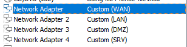

## Étape 1 — Assigner les interfaces dans pfSense (console noire)

Dans la console de pfSense, j’ai utilisé l’option *Assign**Interfaces* pour attribuer mes cartes réseau aux différents segments. J’ai défini :

em0 → WAN (VMnet8 NAT)

em1 → LAN (192.168.6.0/24)

em2 → SRV (192.168.7.0/24)

em3 → DMZ (192.168.8.0/24)

## Étape 2 — Donner les adresses IP aux interfaces internes

Après réassignation des interfaces, la configuration finale est la suivante :

- WAN (em0) : 192.168.5.128/24, obtenu en DHCP via le réseau NAT VMware,
- LAN (em2) : 192.168.6.254/24,
- SRV (em3) : 192.168.7.254/24,
- DMZ (em1) : 192.168.8.254/24.Cette organisation permet d’assurer la séparation entre les différents réseaux et d’identifier clairement chaque rôle.
- Le choix de l’adresse .254 pour chaque réseau permet d’identifier facilement le pare-feu comme passerelle par défaut.

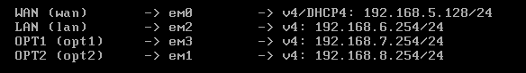

## Étape 3 — Accès à l’interface web de pfSense

- Depuis le PC-Administrateur du réseau LAN, j’ai attribué l’adresse 192.168.6.10/24 avec comme passerelle 192.168.6.254. J’ai ensuite accédé à l’interface web de pfSense via l’URL https://192.168.6.254 et je me suis connecté avec les identifiants par défaut. L’interface graphique du firewall était alors disponible.

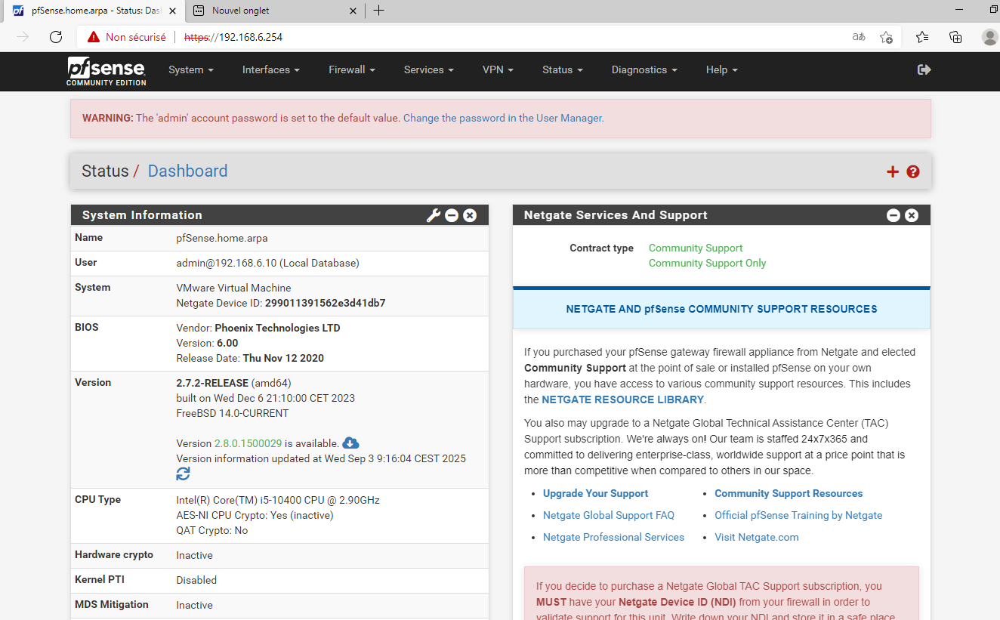

## Etape 4 — Activer le serveur DHCP LAN

- J’ai activé le serveur DHCP sur l’interface LAN de pfSense et défini une plage d’adresses allant de 192.168.6.100 à 192.168.6.200. La passerelle par défaut a été fixée à 192.168.6.254. Après avoir remis le poste Administrateur en configuration automatique, celui-ci a correctement obtenu une adresse IP et a pu accéder à Internet via pfSense.

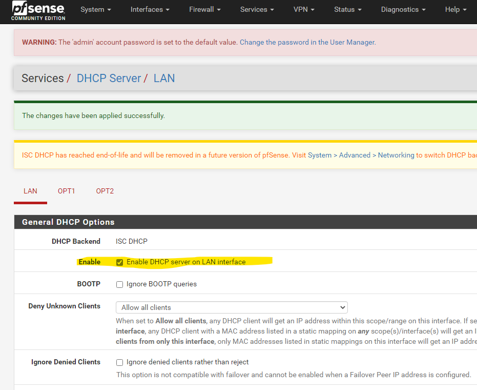

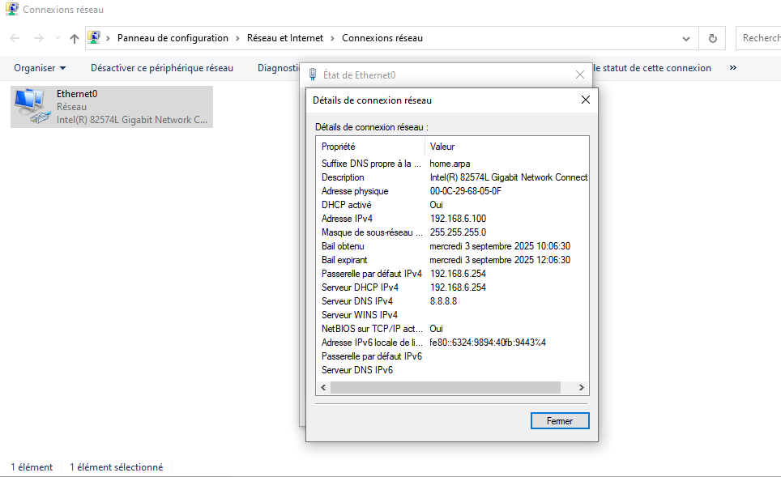

## Étape 5 — Mise en place de la politique de sécurité par défaut

- Après suppression des règles automatiques, il ne reste sur l’interface LAN que la règle “Anti-Lockout” qui permet de conserver l’accès à l’administration du firewall. Toutes les autres communications sont bloquées par défaut, conformément à la politique de sécurité imposée. Les interfaces SRV et DMZ n’ayant pas de règle, elles sont également totalement bloquées.

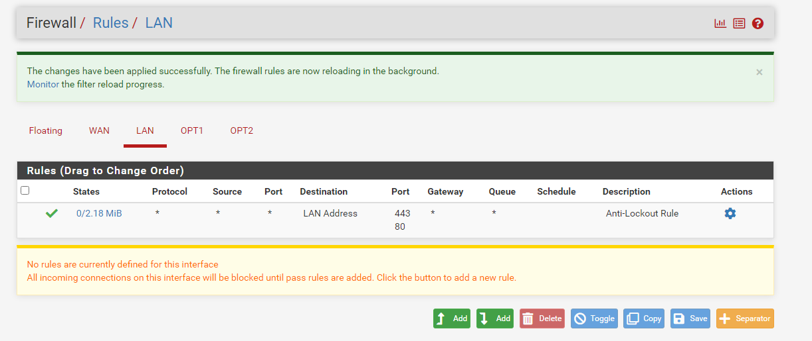

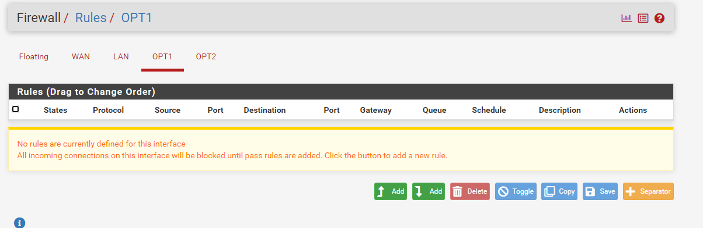

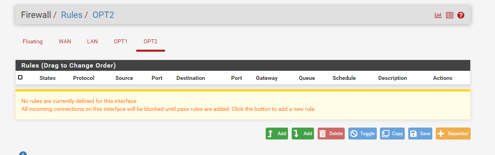

## Étape 6 — Création des alias et règles spécifiques

Afin de simplifier la configuration du firewall, j’ai créé des alias regroupant à la fois les machines et les services. Pour les hôtes, des alias ont été définis pour PC1 (192.168.6.11), PC-Administrateur (192.168.6.10), le serveur Active Directory (192.168.7.10) et le serveur Web (192.168.8.10). Pour les ports, des alias permettent de centraliser les flux liés à l’Active Directory (ADDS_Ports), à la navigation Internet (HTTP, HTTPS, DNS), aux connexions RDP, SSH et aux services Web. Cela rend les règles de firewall beaucoup plus lisibles et faciles à maintenir.

- J’ai configuré des baux DHCP statiques pour que PC-Administrateur (192.168.6.10) et PC1 (192.168.6.11) conservent toujours la même adresse IP, garantissant l’application fiable des règles firewall.

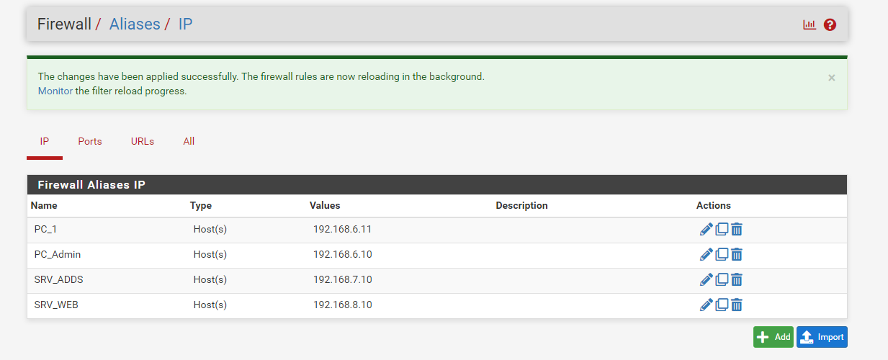

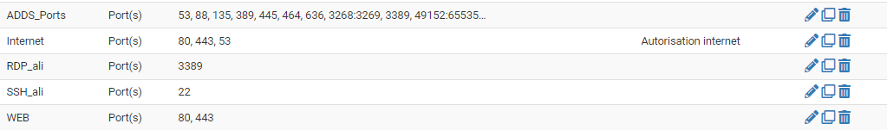

## Étape 7 — Mise en place des règles firewall

### Autoriser les serveurs (AD + WEB) à aller sur Internet

- Sur l’interface SRV, j’ai créé une règle permettant au serveur Active Directory (SRV_ADDS – 192.168.7.10) d’accéder à Internet.La règle est de type **Pass**, avec comme source l’alias **SRV_ADDS**, comme destination **Any**, et limitée aux ports définis dans l’alias **Internet** (HTTP, HTTPS, DNS).Cette configuration autorise le serveur AD à effectuer ses mises à jour et ses requêtes DNS, tout en respectant la politique de restriction des flux.

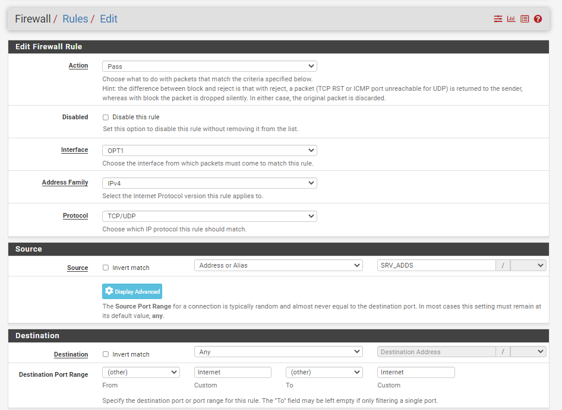

- J’ai ajouté une règle spécifique sur l’interface DMZ et SRV afin de permettre au serveur Web (192.168.8.10 et 192.168.7.10) de communiquer avec Internet. Cette règle autorise uniquement les ports HTTP, HTTPS et DNS, en utilisant l’alias Internet. Associée aux règles de blocage, elle garantit que le serveur Web reste isolé tout en ayant accès aux services extérieurs nécessaires.

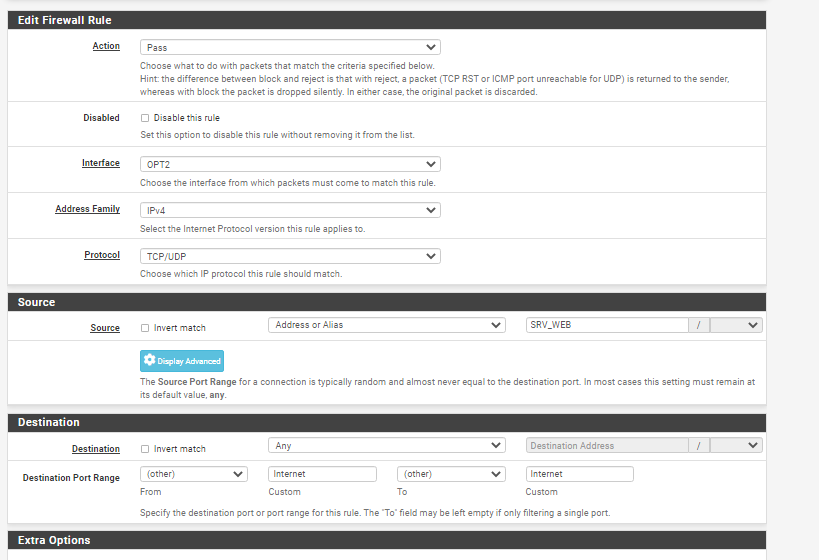

### Bloquer les communications inter-réseaux

J’ai ajouté six règles explicites de type *Block* pour interdire toute communication directe entre les réseaux internes.

Sur l’interface LAN, les flux vers SRV (OPT1 subnets) et DMZ (OPT2 subnets) sont bloqués.

Sur l’interface SRV, les communications vers LAN et DMZ sont bloquées.

- Enfin, sur l’interface DMZ, les flux vers LAN et SRV sont bloqués.Ainsi, chaque réseau est totalement isolé des autres, conformément à la politique de sécurité définie.

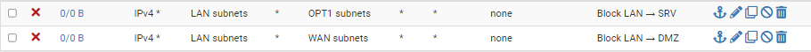

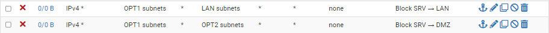

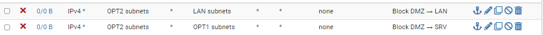

### Autoriser PC1 → SRV_WEB

- Sur l’interface LAN, j’ai ajouté une règle permettant uniquement au poste PC1 (192.168.6.11) d’accéder au serveur Web (192.168.8.10) en HTTP et HTTPS. La règle utilise les alias PC1, SRV_WEB et WEB afin de simplifier la configuration. Cette autorisation est exclusive : aucun autre poste du LAN ne peut atteindre le serveur Web.

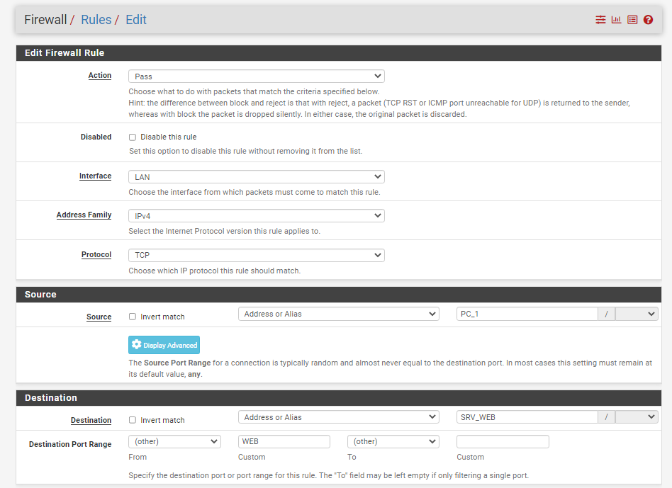

### Autoriser le LAN à joindre le domaine

- J’ai configuré une règle sur l’interface LAN permettant aux postes du réseau 192.168.6.0/24 de contacter le serveur Active Directory (192.168.7.10) uniquement sur les ports nécessaires au fonctionnement d’un domaine : DNS, Kerberos, LDAP, SMB, LDAPS et Global Catalog. Cette règle, utilisant l’alias ADDS_Ports, garantit que le LAN peut rejoindre et utiliser le domaine tout en limitant les flux aux services essentiels.

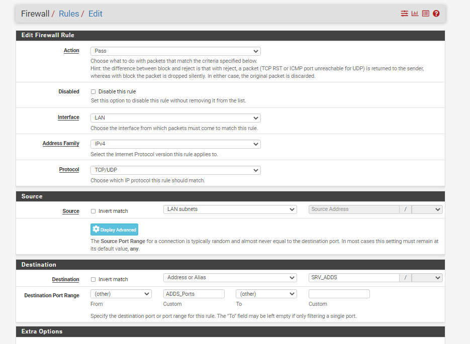

### Autoriser PC-Admin (accès RDP et SSH)

- Pour l’administration, j’ai ajouté deux règles spécifiques sur l’interface LAN. La première autorise uniquement PC-Administrateur (192.168.6.10) à établir une connexion RDP (port 3389) vers le serveur SRV (192.168.7.10). La seconde permet uniquement à ce même poste de se connecter en SSH (port 22) au serveur Web en DMZ (192.168.8.10). Ces règles garantissent que seul le poste d’administration désigné dispose d’un accès privilégié aux serveurs internes.

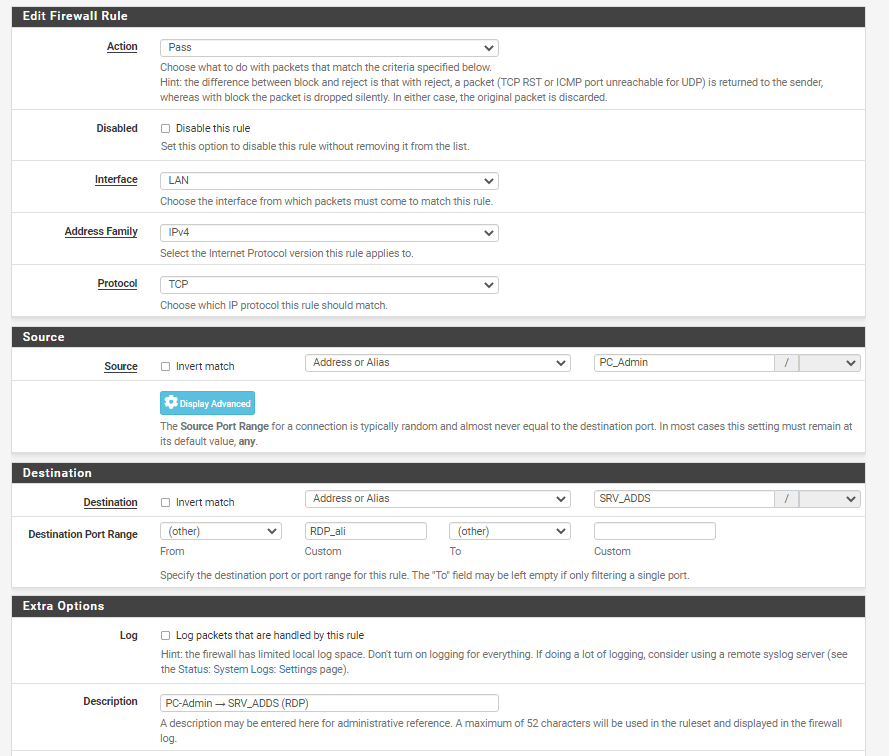

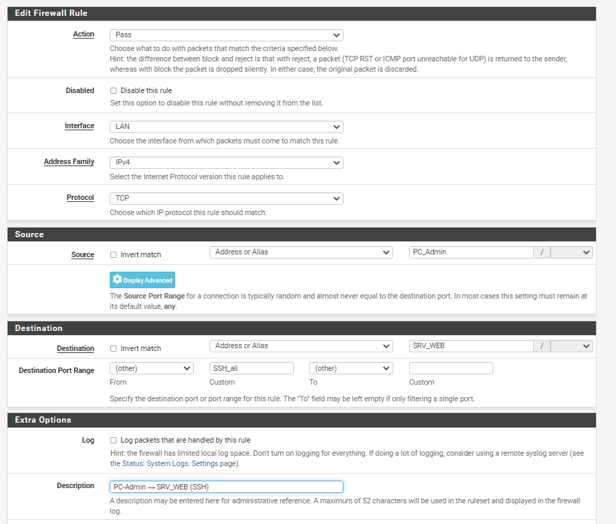

### Étape 8 — Tests globaux

### Tests Serveurs → Internet

Depuis SRV_ADDS (192.168.7.10) :

- ping 8.8.8.8 → doit répondre

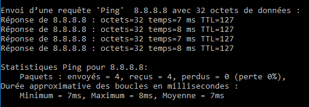

- Depuis SRV_WEB (192.168.8.10) : mêmes tests →

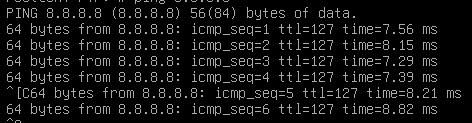

### Blocage inter-réseaux

- Depuis PC1 (192.168.6.11) → ping SRV_ADDS (192.168.7.10) → doit échouer

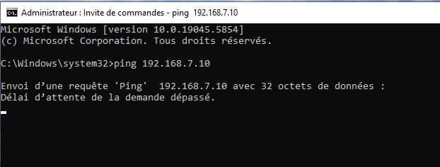

- Depuis PC1 → ping SRV_WEB (192.168.8.10) → doit échouer (sauf ports HTTP/HTTPS → voir test 3)

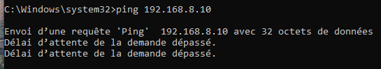

- Depuis SRV_ADDS → ping LAN ou DMZ → doit échouer

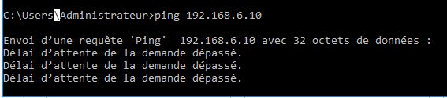

- Depuis SRV_WEB → ping LAN ou SRV → doit échouer

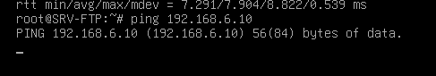

### Accès Web de PC1

- Depuis PC1 (192.168.6.11) → ouvrir navigateur sur http://192.168.8.10

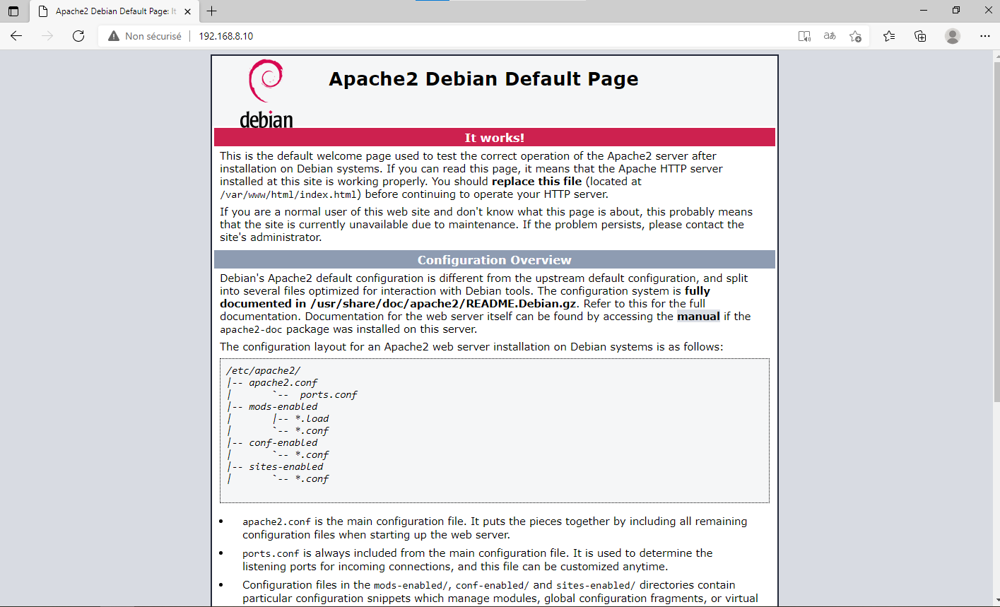

### Accès au domaine

- Depuis **PC1** ou **PC-Admin** → joindre le domaine

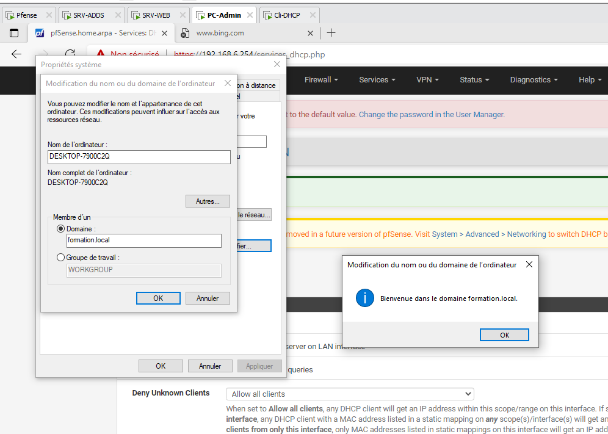

### Accès Admin privilégié

### Depuis PC-Admin (192.168.6.10) :

- Connexion RDP → 192.168.7.10 (SRV_ADDS) → fonctionne

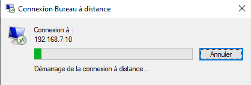

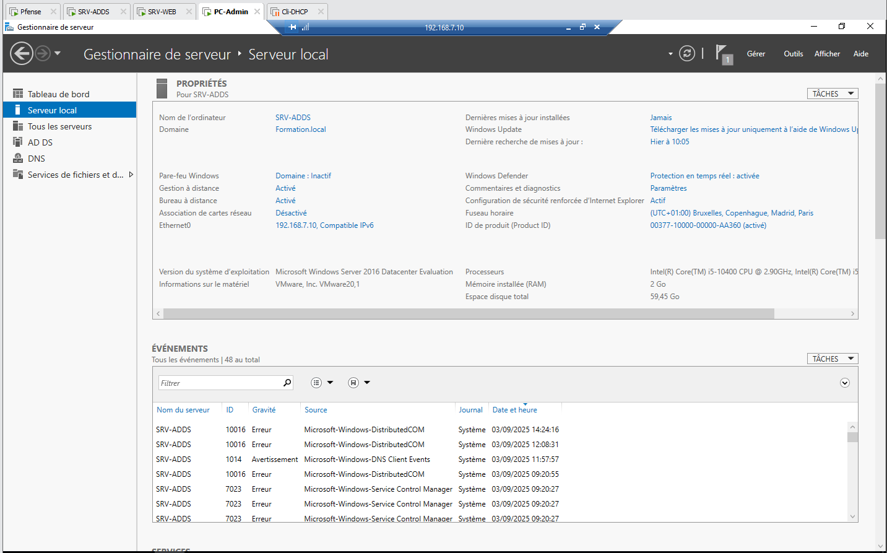

- Connexion SSH → 192.168.8.10 (SRV_WEB) → fonctionne

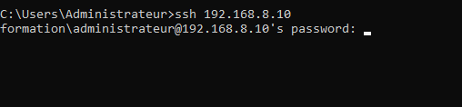

Les tests de validation confirment que la configuration pfSense respecte les règles de sécurité définies. Les serveurs SRV-ADDS et SRV-WEB accèdent correctement à Internet. Les réseaux LAN, SRV et DMZ sont isolés entre eux, aucune communication croisée n’est possible. Le poste PC1 peut accéder uniquement au serveur Web via HTTP/HTTPS, tandis que PC-Administrateur dispose d’un accès exclusif en RDP au serveur ADDS et en SSH au serveur Web. Enfin, les postes du LAN peuvent rejoindre le domaine. Tous les objectifs du projet sont donc atteints.