# Fiche Technique

*Déploiement d’un certificat SSL interne avec pfSense, Apache et Active Directory*


> Ce document complète la maquette décrite dans [le TP pfSense](README.md)

## Sommaire

- [Export du certificat et de la clé](#export-du-certificat-et-de-la-clé)
- [Déployer certificat SSL Pfsense-ca sur Debian (Apache)](#déployer-certificat-ssl-pfsense-ca-sur-debian-apache)
- [Déployer le CA pfSense via GPO (Windows Server)](#déployer-le-ca-pfsense-via-gpo-windows-server)
- [Enregistrement DNS à ajouter](#enregistrement-dns-à-ajouter)
- [Accès en HTTPS](#accès-en-https)

| Rédigé par | Illyes Zerga |
|---|---|
| Date | 09/09/25 |

**Création d’une autorité de certification**

Dans pfSense, aller dans System > Cert. Manager > CAs.

Cliquer sur Add pour créer une nouvelle CA interne.

- Enregistrer → La CA sera utilisée pour signer les certificats serveur et utilisateurs.

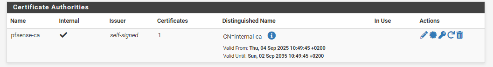

**Création du certificat pour le serveur SRV-WEB**

Aller dans System > Cert. Manager > Certificates.

Cliquer sur Add/Sign.

- Enregistrer → le serveur OpenVPN aura son propre certificat signé par la CA.

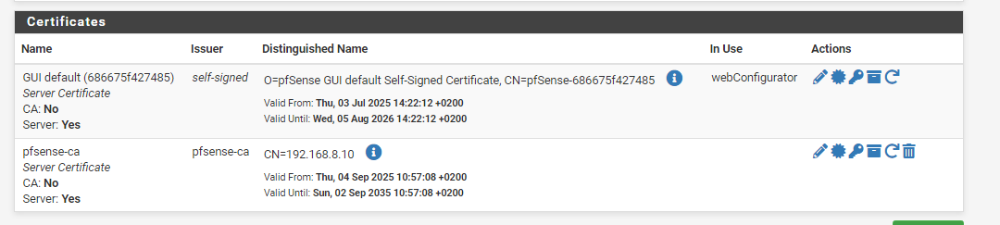

## Export du certificat et de la clé

- Nous allons cliquer sur ces 2 icones afin d’exporter le certificat et la clé respectivement :

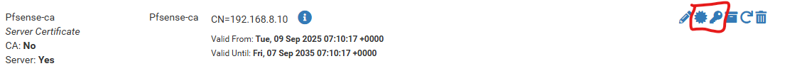

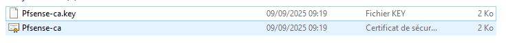

## Déployer certificat SSL Pfsense-ca sur Debian (Apache)

Déplacer les fichiers dans les répertoires standards :

```bash
sudo mv /root/Pfsense-ca.crt /etc/ssl/certs/
sudo mv /root/Pfsense-ca.key /etc/ssl/private/
```

Il faut verrouiller les droits de la clé :

```bash
sudo chmod 600 /etc/ssl/private/Pfsense-ca.key
sudo chown root:root /etc/ssl/private/Pfsense-ca.key
```

Activer SSL dans Apache :

```bash
sudo a2enmod ssl
sudo a2enmod headers
sudo a2ensite default-ssl.conf
```

- Éditer /etc/apache2/sites-available/default-ssl.conf et configurer :

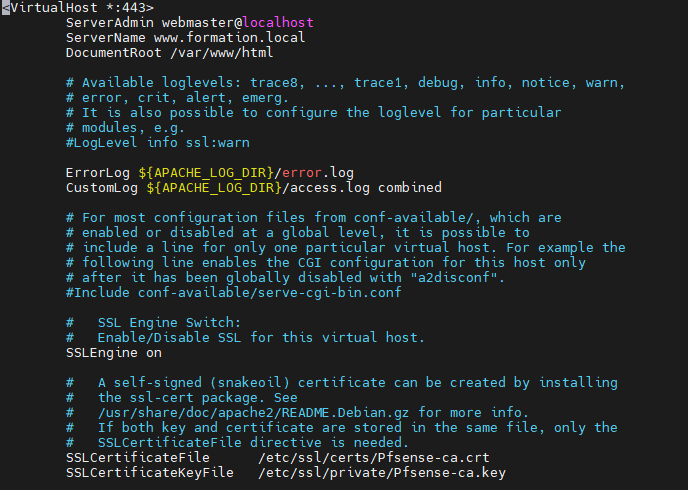

Redémarrage d’Apache :

```bash
sudo apache2ctl configtest
sudo systemctl reload apache2
```

## Déployer le CA pfSense via GPO (Windows Server)

Exporter le CA depuis pfSense :

- Attention : c’est bien le **CA** qu’il faut exporter, pas le certificat serveur.

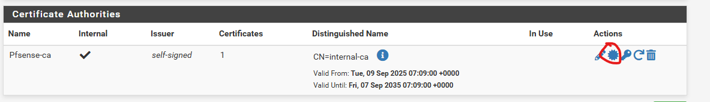

- Le recuperer sur le `<SERVEUR>` :

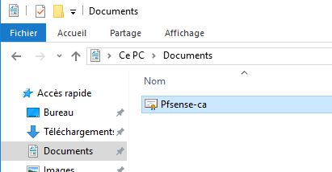

Ensuite dans la gestion des stratégies de groupe on va créer ou modifier une GPO qui s’appliquera aux ordinateurs

Naviguer dans :Configuration ordinateur > Paramètres Windows > Paramètres de sécurité > Stratégies de clé publique > Autorités de certification racines de confiance

Clic droit → Importer.

- Sélectionner le fichier pfsense-ca.crt

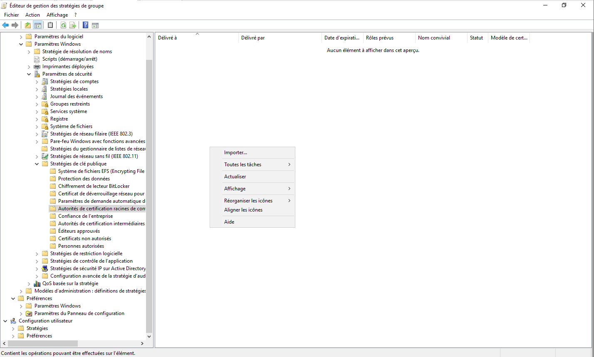

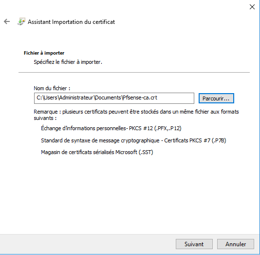

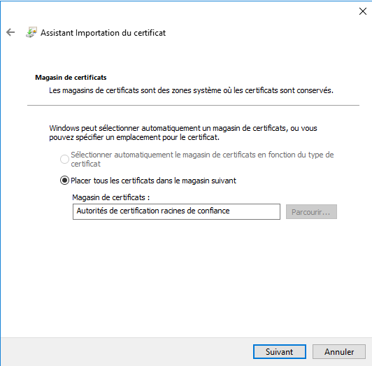

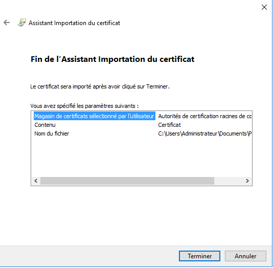

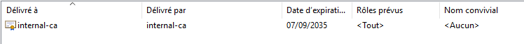

Pour forcer la mise à jour des stratégies sur les PC clients du domaine :

```bash
gpupdate /force
```

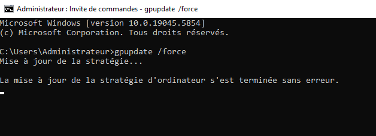

## Enregistrement DNS à ajouter

Ouvrir la console DNS Manager :

Dans ta zone formation.local, ajoute un **enregistrement A** :

Nom : www

- Adresse IP : (IP du serveur Web, ex. `<IP_DU_SERVEUR>`)

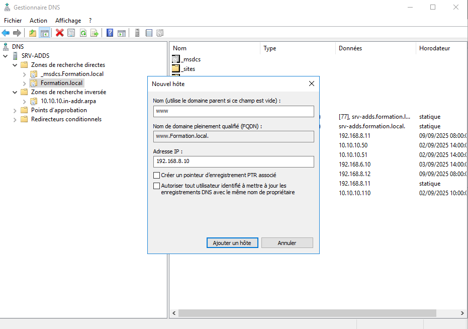

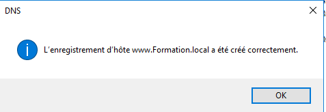

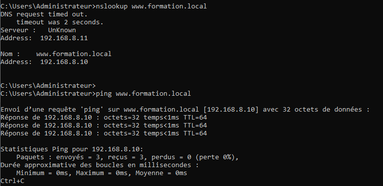

## Accès en HTTPS

Une fois la résolution DNS OK :

Ouvre https://www.formation.local dans ton navigateur.

- Si le CA pfSense est bien installé via GPO, le certificat doit être reconnu comme valide (cadenas vert).

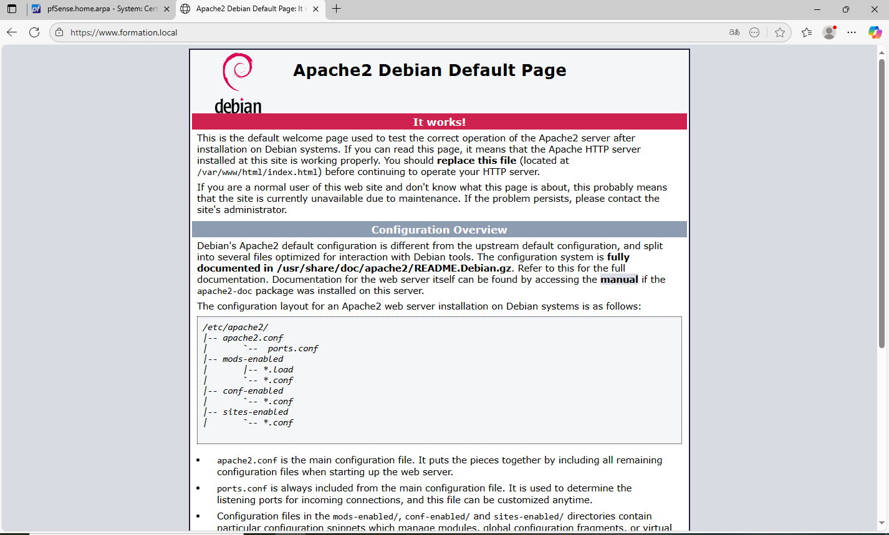